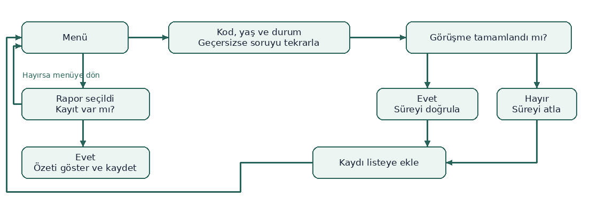
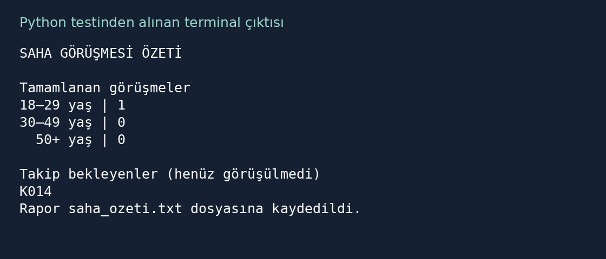

# Saha Görüşmesi Planlayıcısı

Sosyologlar ve saha araştırması ekipleri için görüşme kayıtlarının oturum özetini çıkaran bir Python 3 uygulaması.

## Çalıştırma

Proje klasöründe terminali aç ve `python uygulama.py` çalıştır. Windows’ta `py uygulama.py` komutunu da kullanabilirsin. Ek paket gerekmez.

1. Menüde `1` ile kayıt ekle. `K015` gibi bir kod, yaş grubu ve görüşme durumu gir.
2. Görüşme tamamlandıysa süreyi pozitif tam sayı olarak yaz. Takip bekleyen görüşmelerde süre sorusu atlanır.
3. Menüde `2` ile raporu göster ve çalışma klasöründeki `saha_ozeti.txt` dosyasına kaydet.

Aynı kod bir oturumda yalnızca bir kez kullanılabilir. Kayıt yoksa program menüye döner. Her geçerli rapor aynı dosyayı günceller. Program açılışta eski kayıtları yüklemez. Testlerde hayalî katılımcı kodları kullanılmıştır.

## Akış şeması



## Doğrulama

| Girdi | Beklenen | Gerçek |
|---|---|---|
| K001 tamamlandı, 25 dk. K014 takipte. | 18–29 grubunda 1 tamamlanan. Takipte K014. | 18–29 grubunda 1 görüşme sayıldı. Takip listesinde yalnız K014 vardı ve süre bir kez soruldu. |
| Boş kod, ardından K001. | Kod sorusu tekrarlanır. | Boş kod uyarısı çıktı. Kod yeniden soruldu ve K001 kaydedildi. |
| Yaş seçimi 9, ardından 1. | Yaş sorusu tekrarlanır. | Seçim uyarısı çıktı. Yaş yeniden soruldu ve 1 kabul edildi. |
| 0 ve 2,5 dk, ardından 25 dk. | İki uyarı verilir, 25 kabul edilir. | İki süre uyarısı çıktı. 25 kabul edildi ve görüşme sayıldı. |
| K001, ardından k001 ve K014. | k001 reddedilir, K014 kabul edilir. | k001 için tekrar uyarısı çıktı. Takip listesinde yalnız K014 vardı. |
| İlk menüde 2, ardından geçerli kayıt. | Uyarıdan sonra menü tekrar gösterilir. | Kayıt yok uyarısı çıktı. Menüye dönüldü ve geçerli kayıtla rapor yazıldı. |
| Ornek Kisi ve K15, ardından k015. | İlk iki giriş reddedilir, K015 kabul edilir. | İki biçim uyarısı çıktı. Takip listesinde yalnız K015 vardı. |

## Terminal çıktısı

Aşağıdaki metin normal testte Python’dan alınan rapor ve kayıt bildirimidir.

```text
SAHA GÖRÜŞMESİ ÖZETİ

Tamamlanan görüşmeler
18–29 yaş | 1
30–49 yaş | 0
  50+ yaş | 0

Takip bekleyenler (henüz görüşülmedi)
K014
Rapor saha_ozeti.txt dosyasına kaydedildi.
```



[YZ ile çalışma günlüğü](PROMPTLAR.md)
